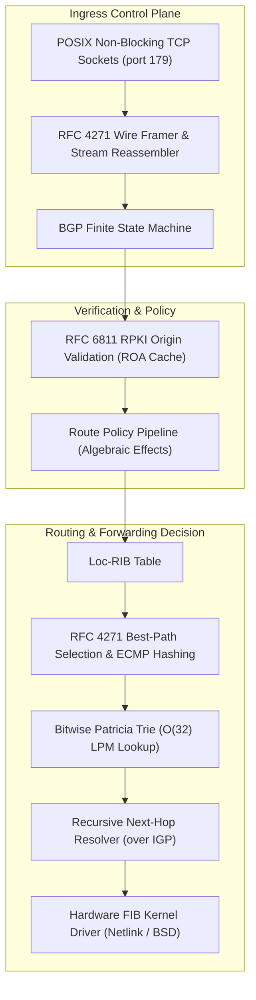

# Purlin

An Autonomous System BGP-4 and Multiprotocol BGP (MP-BGP) routing engine implemented in Koka with zero-allocation bitwise Patricia-trie Longest Prefix Match (LPM) routing, algebraic effect-driven route policies, RFC 6811 RPKI prefix origin validation, RFC 7432 / RFC 9136 EVPN control plane, hardware Forwarding Information Base (FIB) recursive resolution, and an in-memory RFC 7938 Clos spine-leaf datacenter fabric simulator.

---

## Overview

Purlin demonstrates how typed functional programming with algebraic effect handlers can replace procedural, state-entangled control plane code in high-performance networking:

- **Core Routing Engine in Koka:** Pure functional immutable state transitions, algebraic data structures for RFC 4271 BGP wire framing, 4-byte ASNs (RFC 6793), capabilities negotiation (RFC 5492), and ADD-PATH (RFC 7911).
- **Algebraic Effect Route Policies:** Route filtering, attribute mutation, and telemetry auditing modeled as native algebraic effects (`route-effect`), enabling modular composition of filter chains without side-effect pollution.
- **Bitwise Patricia-Trie LPM:** Radix trie indexing with branch node colocation, $O(32)$ bounded longest prefix match lookups, and automatic path compression upon route withdrawal.
- **RPKI Origin Validation:** Complete RFC 6811 tri-state validation (`Valid`, `Invalid`, `NotFound`) backed by an in-memory Route Origin Authorization (ROA) trie cache and RFC 8210 RPKI-to-Router (RTR) client framing.
- **Hardware Forwarding Information Base (FIB):** Recursive next-hop resolution over connected interfaces and Interior Gateway Protocol (IGP) underlay routes with Linux Netlink / BSD route programming adapters.
- **RFC 7938 Clos Fabric Simulator:** An in-memory 5-node spine-leaf datacenter network simulation testing BGP convergence, Equal-Cost Multi-Path (ECMP) 5-tuple flow hashing, and link-failure failovers.
- **Web Operations Console:** Real-time topology visualizer and operator dashboard for live RIB inspection, link-cut injection, and path telemetry.

---

## Architecture



---

## Directory Structure

```
purlin/
├── src/
│   ├── proto/            # BGP-4 / MP-BGP wire codecs, FSM, and capabilities
│   │   ├── types.kk      # Strongly typed IPv4/IPv6, ASN, and Router ID
│   │   ├── wire.kk       # RFC 4271 framing, serialization, and stream parser
│   │   ├── caps.kk       # RFC 5492 capabilities (4-byte ASN, MP-BGP, ADD-PATH)
│   │   ├── attrs.kk      # Path attribute codecs and AS_PATH loop detection
│   │   └── fsm.kk        # RFC 4271 FSM, timers, and collision resolution
│   ├── rib/              # Routing Information Base and decision logic
│   │   ├── patricia.kk   # Bitwise Patricia trie with Longest Prefix Match
│   │   ├── rib.kk        # Adj-RIB-In, Loc-RIB, and peer path tracking
│   │   ├── decision.kk   # Deterministic 8-step RFC 4271 best-path tie-breaking
│   │   └── ecmp.kk       # Equal-Cost Multi-Path grouping and 5-tuple flow hashing
│   ├── policy/           # Declarative route policies and algebraic effects
│   │   ├── ast.kk        # Route policy AST, prefix lists, and AS-path filters
│   │   ├── effects.kk    # Native algebraic effect signatures for route filtering
│   │   └── eval.kk       # Composable policy evaluation pipeline and handlers
│   ├── rpki/             # Resource Public Key Infrastructure validation
│   │   ├── roa.kk        # Route Origin Authorization cache and trie indexing
│   │   ├── rpov.kk       # RFC 6811 tri-state prefix origin validation algorithm
│   │   └── rtr.kk        # RFC 8210 RPKI-to-Router protocol wire codecs
│   ├── evpn/             # BGP EVPN and VXLAN overlay control plane
│   │   ├── types.kk      # MAC address, RD, RT, ESI, and VNI primitives
│   │   ├── nlri.kk       # EVPN Type 2, Type 3, and Type 5 NLRI encoders
│   │   └── vrf.kk        # Virtual Routing and Forwarding tenant isolation
│   ├── damping/          # Route flap damping subsystem
│   │   ├── penalty.kk    # RFC 2439 exponential decay and reuse curves
│   │   └── flap.kk       # Flap history tracking and periodic decay sweeps
│   ├── fib/              # Forwarding Information Base and hardware glue
│   │   ├── types.kk      # FIB routing entries, interfaces, and next hops
│   │   └── recursive.kk  # Multi-hop recursive resolution over IGP underlay
│   ├── engine/           # Daemon coordinator and session management
│   │   ├── session.kk    # Peer session lifecycle and stream buffering
│   │   ├── scheduler.kk  # Event dispatcher, timer deadlines, and poll loop
│   │   ├── daemon.kk     # Top-level routing daemon orchestrator
│   │   └── reflector.kk  # RFC 4456 route reflection and cluster loop check
│   ├── sim/              # Datacenter Clos fabric simulation
│   │   ├── clos.kk       # RFC 7938 spine-leaf topology and link definitions
│   │   └── fabric.kk     # In-memory packet delivery and failover engine
│   ├── cli/              # Operator command-line interface
│   │   ├── parser.kk     # Command argument parser
│   │   ├── format.kk     # High-density terminal tables for BGP, RIB, FIB
│   │   └── main.kk       # CLI entrypoint and interactive runner
│   ├── api/              # Telemetry and observability
│   │   └── metrics.kk    # Prometheus text metric exporter (RFC compliant)
│   └── c/                # Low-latency C kernel bindings
│       ├── socket.c      # Non-blocking POSIX TCP socket bridge with DSCP CS6
│       ├── socket.h      # C socket API declarations
│       ├── fib_nl.c      # Linux Netlink / BSD route programming adapter
│       └── fib_nl.h      # Kernel FIB interface headers
├── test/
│   ├── unit/             # Unit test suites (policy, RPKI, EVPN, damping)
│   ├── integration/      # Multi-peer sessions, route reflector, Clos fabric
│   └── regression/       # Wire fuzz regressions and edge-case validations
├── bench/                # Microbenchmarks for Patricia trie and policy effects
├── harness/              # Automated Python testbench, conformance, and chaos runner
├── web/                  # Web-based Clos topology visualizer and operator console
└── docs/                 # In-depth architectural and operational specifications
```

---

## Quickstart

### Prerequisites

- [Koka Compiler](https://koka-lang.github.io/koka/doc/index.html) version 3.2.0 or newer.
- GCC or Clang with C11 support.
- Python 3.9+ for testbenches and conformance suites.
- Make.

### Building

Compile the C kernel glue and verify Koka module integrity:

```bash
make all
```

### Running Test Suites

Run the complete test suite including unit tests, multi-router integration tests, and RFC route reflector verification:

```bash
make test
```

### Running Protocol Conformance and Chaos Harnesses

Execute automated RFC wire verification, boundary fuzzing, and Clos fabric failover simulations:

```bash
make testbench
```

### Running Performance Benchmarks

Benchmark Patricia-trie LPM lookup throughput and algebraic effect policy evaluation:

```bash
make bench
```

### Launching the Clos Fabric Web Visualizer

Start a local static server to inspect the 5-node Clos spine-leaf datacenter fabric:

```bash
cd web && python3 -m http.server 8080
```
Open `http://localhost:8080` in your browser.

---

## Technical Specifications

- [Architecture Specification](docs/ARCHITECTURE.md): Formal models of Patricia-trie memory layout, algebraic effects, and recursive FIB resolution.
- [Protocol Conformance Matrix](docs/RFC_CONFORMANCE.md): Clause-by-clause traceability against RFC 4271, RFC 4456, RFC 4760, RFC 5492, RFC 6793, RFC 6811, RFC 7432, RFC 7911, RFC 7938, and RFC 8210.
- [Route Policy DSL Manual](docs/POLICY_DSL.md): Declarative policy language syntax, pattern matching rules, and effect handler pipelines.
- [Operator Guide & Runbooks](docs/OPERATOR_GUIDE.md): CLI reference, Prometheus metric catalog, and operational troubleshooting runbooks.

---

## License

This project is licensed under the ISC License. See the [LICENSE](LICENSE) file for details.
