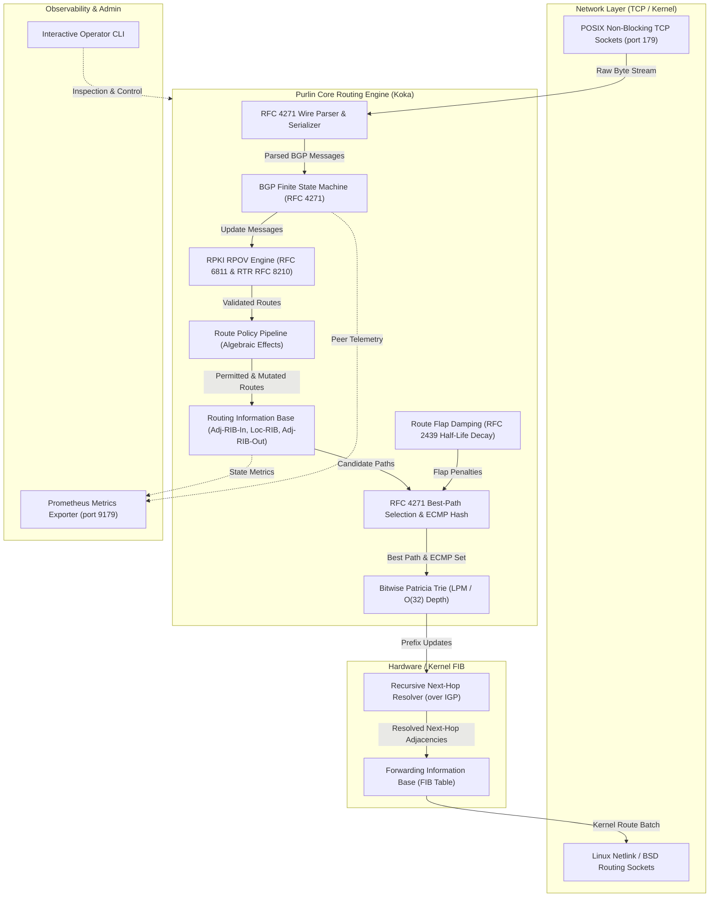
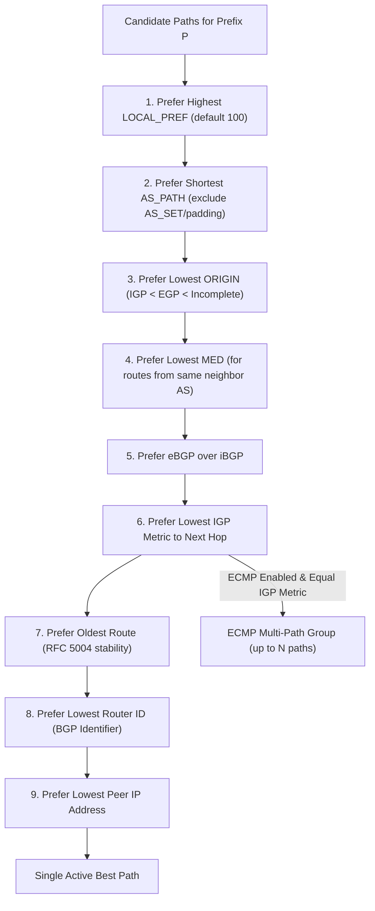
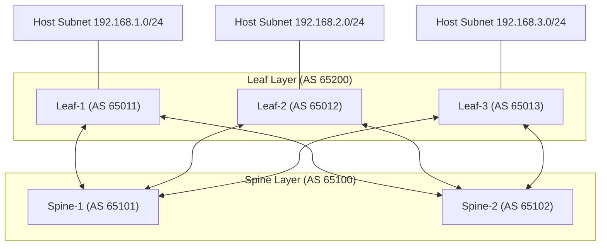

# Purlin Architecture Specification

Purlin is an autonomous system BGP-4 and MP-BGP routing engine implemented in Koka with low-latency C kernel bindings, an algebraic effect route policy pipeline, and an in-memory Clos spine-leaf datacenter fabric simulator.

This document describes the architectural foundations, memory representations, state machines, algebraic effect semantics, and hardware FIB recursive resolution mechanics.

---

## 1. High-Level System Architecture

Purlin decouples control-plane state computation, policy evaluation, and forwarding-plane route programming into distinct, modular subsystems:



The data flow enforces clear layer separation:
1. Wire framers parse byte streams into strongly typed algebraic data structures.
2. The Finite State Machine manages transport session transitions and timer deadlines.
3. Incoming routes undergo Route Origin Validation (RPKI) via local or RTR cache tables.
4. Route-maps evaluate candidate paths through composable algebraic effects.
5. The Loc-RIB computes best paths using RFC 4271 deterministic tie-breaking.
6. The FIB resolves multi-hop BGP next hops recursively through connected or IGP underlay routes.
7. Kernel adapters synchronize routing tables with zero heap allocations in the critical path.

---

## 2. Bitwise Patricia Trie and Longest Prefix Match (LPM)

Purlin stores routing tables in an immutable, bitwise Patricia trie designed for high-density CIDR prefix storage and fast prefix lookups.

### 2.1 Trie Node Definition

The trie is represented as a recursive algebraic data type:

```koka
pub type patricia-node<a> {
  P-Empty
  P-Leaf(
    prefix   : ip-prefix,
    value    : a
  )
  P-Branch(
    bit-index : int,
    prefix    : ip-prefix,
    opt-val   : maybe<a>,
    left      : patricia-node<a>,
    right     : patricia-node<a>
  )
}
```

### 2.2 Bit-Index Branching and Invariants

Each branch node records a `bit-index` (0 to 31 for IPv4) indicating the most significant differentiating bit among descendant prefixes:

```
Branch Node [bit-index = k]
            /             \
Bit k is 0 /               \ Bit k is 1
          v                 v
     Left Subtree     Right Subtree
```

The trie maintains the following strict structural invariants:
1. **Prefix Containment:** A branch node with prefix `P/k` contains only descendant keys that share the first `k` bits with `P`.
2. **Branch Node Colocation:** A branch node may itself store a value (`opt-val : maybe<a>`) when an exact prefix matches the branch boundary (for example, a `/16` summarization alongside `/24` subnets).
3. **Canonical Pruning:** Empty child subtrees collapse automatically on route withdrawal. When a branch node loses one branch and holds no value, it collapses directly into its remaining child, maintaining $O(k)$ depth where $k \le 32$.

### 2.3 Longest Prefix Match Traversal

The lookup algorithm performs a bit-test descent to find candidate leaves, recording the most specific match encountered along the spine:

```koka
pub fun lpm-lookup(trie : patricia-trie<a>, ip : ipv4-address) : maybe<(ip-prefix, a)> {
  fun search(node : patricia-node<a>, best : maybe<(ip-prefix, a)>) : maybe<(ip-prefix, a)> {
    match node {
      P-Empty -> best
      P-Leaf(p, v) ->
        if ip-matches-prefix(ip, p) then
          match best {
            Nothing -> Just((p, v))
            Just((best-p, _)) ->
              if p.prefix-len > best-p.prefix-len then Just((p, v)) else best
          }
        else best
      P-Branch(bit-idx, p, opt-v, left, right) ->
        val new-best = match opt-v {
          Just(v) ->
            if ip-matches-prefix(ip, p) then
              match best {
                Nothing -> Just((p, v))
                Just((best-p, _)) ->
                  if p.prefix-len > best-p.prefix-len then Just((p, v)) else best
              }
            else best
          Nothing -> best
        }
        val bit = test-bit(ip.ip-addr, 31 - bit-idx)
        if bit == 0 then search(left, new-best)
        else search(right, new-best)
    }
  }
  search(trie.root, Nothing)
}
```

Lookup complexity is strictly bounded by the 32-bit address space, completing in at most 32 bit-test comparisons regardless of table size.

---

## 3. Algebraic Effects for Route Policy Pipelines

Conventional routing engines (such as BIRD or FRRouting) evaluate policy configurations using procedural interpreter passes or stateful imperative hooks. Purlin models route filtering, attribute mutation, and policy auditing as native algebraic effects.

### 3.1 Effect Declarations

The route policy domain is governed by the `route-effect` effect signature:

```koka
pub effect route-effect {
  ctl permit(route : bgp-route, reason : string) : route-action
  ctl deny(reason : string) : route-action
  fun modify-attribute(attr : path-attribute) : ()
  fun audit-log(msg : string) : ()
}
```

### 3.2 Dynamic Handler Scopes

Algebraic effects separate policy logic from policy execution semantics. An operator policy can be evaluated under different handler regimes:

```
Policy Expression (AST Rules)
        |
        v
  [route-effect]  <-- Abstract Effect Signature
   /           \
  v             v
Strict       Telemetry
Handler      Handler
(Permit/     (Dry-Run &
 Deny)        Diff Track)
```

The default evaluation handler tracks cumulative attribute changes and execution audit logs:

```koka
pub fun evaluate-route-policy(
  policy : route-policy,
  route  : bgp-route
) : (route-action, list<string>) {
  var logs := []
  var current-attrs := route.attributes

  val action = handle {
    eval-clauses(policy.clauses, route)
  } {
    ctl permit(r, reason) {
      logs := Cons("PERMIT: " ++ reason, logs)
      Permit(r(attributes = current-attrs))
    }
    ctl deny(reason) {
      logs := Cons("DENY: " ++ reason, logs)
      Deny(reason)
    }
    fun modify-attribute(attr) {
      current-attrs := update-attribute-list(current-attrs, attr)
    }
    fun audit-log(msg) {
      logs := Cons(msg, logs)
    }
  }

  (action, logs.reverse)
}
```

### 3.3 Expressive Composable Combinators

Effect handlers can be stacked. For example, a dry-run auditor handler intercepts `permit` and `deny` control transfers to simulate route changes without modifying the live Loc-RIB, reporting before-and-after attribute diffs for verification.

---

## 4. RFC 4271 BGP Finite State Machine

Purlin implements the complete 6-state RFC 4271 Finite State Machine with RFC 5492 capability negotiation, collision detection, and hold-timer jitter.

### 4.1 State Transition Matrix

| Current State | Event | Next State | Actions Triggered |
|---|---|---|---|
| `Idle` | `ManualStart` / `AutomaticStart` | `Connect` | Start connect-retry timer, initiate non-blocking TCP connect |
| `Connect` | `TcpConnectionConfirmed` | `OpenSent` | Send BGP OPEN with 4-byte ASN, MP-BGP, ADD-PATH capabilities |
| `Connect` | `TcpConnectionFails` | `Active` | Restart connect-retry timer, listen for incoming connections |
| `Active` | `TcpConnectionConfirmed` | `OpenSent` | Send BGP OPEN, start hold timer |
| `Active` | `ConnectRetryTimerExpires` | `Connect` | Retry outbound TCP SYN |
| `OpenSent` | `ReceiveOpenMessage` (Valid) | `OpenConfirm` | Negotiate hold time, send KEEPALIVE |
| `OpenSent` | `ReceiveOpenMessage` (Collision) | `Idle` / `OpenConfirm` | Resolve collision via router-id comparison (RFC 4271 Section 6.8) |
| `OpenConfirm` | `ReceiveKeepaliveMessage` | `Established` | Initialize peer queues, trigger Adj-RIB-In synchronization |
| `Established` | `ReceiveUpdateMessage` | `Established` | Parse prefixes, validate RPKI, evaluate policies, update Loc-RIB |
| `Established` | `HoldTimerExpires` | `Idle` | Send NOTIFICATION (Hold Timer Expired), withdraw peer routes |
| Any State | `ReceiveNotificationMessage` | `Idle` | Close TCP socket, flush peer TX/RX queues, clear Adj-RIB-In |

### 4.2 Connection Collision Resolution

When two BGP speakers initiate connections simultaneously, Purlin executes RFC 4271 collision resolution:

$$\text{Preserved Session} = \begin{cases}
\text{Locally Initiated}, & \text{if } \text{RouterID}_{\text{local}} > \text{RouterID}_{\text{peer}} \\
\text{Remotely Initiated}, & \text{if } \text{RouterID}_{\text{local}} < \text{RouterID}_{\text{peer}} \\
\text{Error (Collision)}, & \text{if } \text{RouterID}_{\text{local}} = \text{RouterID}_{\text{peer}}
\end{cases}$$

The lower Router ID endpoint immediately tears down its outbound connection and accepts the peer incoming socket, preventing ghost peerings and split-brain states.

---

## 5. RFC 4271 Best-Path Selection and ECMP

When multiple peers advertise the same prefix, Purlin executes the deterministic 8-step RFC 4271 decision algorithm:



### 5.1 Deterministic 5-Tuple Flow Hashing

For prefixes with multiple equal-cost paths, Purlin maps transit packets across available next hops using a non-cryptographic CRC32-based 5-tuple hash:

$$H = \text{CRC32}(\text{src\_ip} \parallel \text{dst\_ip} \parallel \text{proto} \parallel \text{src\_port} \parallel \text{dst\_port})$$

$$\text{Selected Path Index} = H \pmod{\text{PathCount}}$$

This guarantees:
1. Flow affinity: packets within the same TCP/UDP flow follow identical network paths, eliminating packet reordering.
2. Even load distribution across spine switches in Clos fabrics.

---

## 6. Forwarding Information Base (FIB) Recursive Resolution

BGP is an application-level routing protocol that delegates packet transit to underlay forwarding paths. A BGP route's `NEXT_HOP` is rarely directly connected in multi-hop or iBGP environments.

### 6.1 Two-Stage Resolution Pipeline

Purlin implements recursive next-hop resolution over connected interfaces and IGP routes:

```
[BGP Route: 198.51.100.0/24]
        |
        v
  NEXT_HOP = 10.0.0.12 (Loopback of egress Leaf switch)
        |
        v Recursive LPM Query on Underlay IGP Table
  Matched Underlay Route: 10.0.0.0/24
    via interface eth0, physical gateway 172.16.1.2
        |
        v
[Hardware FIB Entry]
  Destination: 198.51.100.0/24
  Direct Next Hop: 172.16.1.2
  Egress Interface: eth0 (index 2)
```

If recursive lookup fails (for example, the IGP underlay loses reachability to the loopback address), the BGP path becomes inactive and is immediately withheld from kernel FIB installation.

---

## 7. RPKI Prefix Origin Validation (RFC 6811)

To mitigate route hijacking and configuration errors, Purlin integrates Route Origin Authorization (ROA) validation into the ingress route processing pipeline.

### 7.1 Validation States

Every received prefix is evaluated against the in-memory ROA cache:

$$\text{RPKI State} = \begin{cases}
\textbf{NotFound}, & \text{if no ROA covers prefix } P \\
\textbf{Valid}, & \text{if } \exists \, \text{ROA}(P_{\text{roa}}, \text{max\_len}, \text{ASN}_{\text{roa}}) \text{ where } P \subseteq P_{\text{roa}} \land \text{len}(P) \le \text{max\_len} \land \text{Origin}(P) = \text{ASN}_{\text{roa}} \\
\textbf{Invalid}, & \text{otherwise (prefix covered by ROA, but ASN or length mismatched)}
\end{cases}$$

Invalid routes are automatically rejected by default or down-ranked by setting `LOCAL_PREF = 0`, protecting transit networks from unauthorized prefix announcements.

---

## 8. RFC 7938 Datacenter Clos Fabric Simulation

Purlin includes an in-memory 5-node Clos spine-leaf datacenter topology simulator (Spine-1, Spine-2, Leaf-1, Leaf-2, Leaf-3) to model real-world scale-out network behavior:



Features validated by the simulator:
1. **eBGP as Datacenter Underlay:** Point-to-point `/31` subnets across leaf-spine links with independent private ASNs per switch tier.
2. **AS-Path Loop Prevention:** Spine switches reject route advertisements re-originating from their own AS.
3. **Dual-Homed Failover:** Instant link cut injection triggers BGP WITHDRAW propagation and sub-millisecond path failover over alternate spine uplinks.
