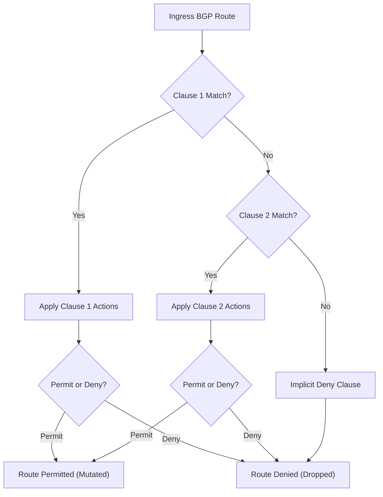

# Declarative Route Policy DSL & Algebraic Effects Manual

Purlin provides a declarative domain-specific policy language (DSL) embedded in Koka. Route policies evaluate incoming and outgoing BGP advertisements, applying prefix-based filtering, AS-path pattern matching, community tagging, and metric modifications.

Rather than relying on mutable imperative state machines, Purlin executes policy evaluation through algebraic effect handlers.

---

## 1. Core Policy Concepts

A Purlin route policy consists of an ordered sequence of policy clauses. Each clause defines:
1. **Match Conditions:** A conjunction of predicates over prefix, AS-path, communities, and existing attributes.
2. **Action Directives:** Mutations to be applied if all match conditions evaluate to true.
3. **Disposition:** Either `Permit` (accept the route with modified attributes) or `Deny` (discard the route).

If a route matches a clause, the specified disposition terminates evaluation for that route, unless non-terminal evaluation is explicitly requested. If no clause matches, the policy defaults to an implicit `Deny`.



---

## 2. Match Condition Syntax & Semantics

### 2.1 Prefix List Matching

Prefix matching supports exact prefix comparison, or CIDR range bounds using `ge` (greater-or-equal length) and `le` (less-or-equal length):

```koka
// Matches exact /24 network
val m1 = MatchPrefix(PrefixMatchExact(ipv4-prefix(192, 168, 1, 0, 24)))

// Matches any /24 to /28 subnet inside 10.0.0.0/8
val m2 = MatchPrefix(PrefixMatchRange(
  prefix  = ipv4-prefix(10, 0, 0, 0, 8),
  min-len = 24,
  max-len = 28
))

// Matches default route 0.0.0.0/0 exactly
val m3 = MatchPrefix(PrefixMatchExact(ipv4-prefix(0, 0, 0, 0, 0)))
```

### 2.2 AS-Path Matching

AS-Path patterns evaluate the origin AS, transit hops, or overall path length:

```koka
// Matches routes originating from AS 65001
val m-origin = MatchAsPath(OriginAs(65001))

// Matches routes transiting through upstream provider AS 174
val m-transit = MatchAsPath(TransitAs(174))

// Matches routes with AS_PATH length exceeding 10 hops (anti-spoofing heuristic)
val m-maxlen = MatchAsPath(MaxPathLength(10))
```

### 2.3 Community List Matching

Community conditions match on standard 32-bit BGP communities (`ASN:Value`):

```koka
// Matches the standard NO_EXPORT community (0xFFFFFF01 / 65535:65281)
val m-noexport = MatchCommunity(CommunityExact(65535, 65281))

// Matches customer-tagged traffic from AS 65000 (65000:100)
val m-cust = MatchCommunity(CommunityExact(65000, 100))
```

### 2.4 RPKI Origin Validation Matching

Clauses can condition on the output of the RPKI validation subsystem:

```koka
// Matches routes verified as RPKI Valid
val m-rpki-valid = MatchRpki(RpkiValid)

// Matches routes detected as RPKI Invalid (hijack attempts)
val m-rpki-invalid = MatchRpki(RpkiInvalid)
```

---

## 3. Route Actions & Attribute Mutations

When a clause matches, its action list executes attribute mutations before route acceptance:

| Action | Function | Example |
|---|---|---|
| `SetLocalPref(val)` | Overrides BGP `LOCAL_PREF` | `SetLocalPref(200)` (prefer primary path) |
| `SetMed(val)` | Overrides Multi-Exit Discriminator | `SetMed(50)` (traffic engineering metric) |
| `PrependAs(asn, count)` | Prepends local ASN N times | `PrependAs(65001, 3)` (deprioritize backup path) |
| `AddCommunity(asn, val)` | Attaches standard community | `AddCommunity(65000, 500)` |
| `StripCommunity(asn, val)` | Removes matching community | `StripCommunity(65000, 100)` |
| `SetNextHop(ip)` | Rewrites `NEXT_HOP` attribute | `SetNextHop(ipv4-addr(10, 0, 0, 1))` |

---

## 4. Algebraic Effects Execution Model

Purlin's policy engine decouples policy evaluation rules from execution side-effects using Koka's algebraic effect system.

### 4.1 Effect Definition

```koka
pub effect route-effect {
  ctl permit(route : bgp-route, reason : string) : route-action
  ctl deny(reason : string) : route-action
  fun modify-attribute(attr : path-attribute) : ()
  fun audit-log(msg : string) : ()
}
```

- `permit`: Control-transfer effect returning the accepted, mutated route.
- `deny`: Control-transfer effect halting evaluation and discarding the route.
- `modify-attribute`: Resumes normal control flow after recording an attribute transformation.
- `audit-log`: Emits structured debugging messages for telemetry and compliance logging.

### 4.2 Standard Production Handler

The production handler accumulates attribute modifications and records execution trails:

```koka
pub fun evaluate-route-policy(
  policy : route-policy,
  route  : bgp-route
) : (route-action, list<string>) {
  var logs := []
  var current-attrs := route.attributes

  val action = handle {
    eval-clauses(policy.clauses, route)
  } {
    ctl permit(r, reason) {
      logs := Cons("PERMIT: " ++ reason, logs)
      Permit(r(attributes = current-attrs))
    }
    ctl deny(reason) {
      logs := Cons("DENY: " ++ reason, logs)
      Deny(reason)
    }
    fun modify-attribute(attr) {
      current-attrs := update-attribute-list(current-attrs, attr)
    }
    fun audit-log(msg) {
      logs := Cons(msg, logs)
    }
  }

  (action, logs.reverse)
}
```

### 4.3 Policy Dry-Run and Simulation Handler

Because effects are first-class, operators can run dry-run simulations to inspect route transformations without affecting live tables:

```koka
pub fun dry-run-policy(
  policy : route-policy,
  route  : bgp-route
) : policy-simulation-report {
  var applied-actions := []
  val (action, audit) = evaluate-route-policy(policy, route)
  build-simulation-report(route, action, audit)
}
```

---

## 5. Production Policy Configurations

### 5.1 Ingress Transit Filter: Bogons, Martians, and RPKI Validation

This policy rejects private/martian IPv4 ranges, drops RPKI invalid announcements, and applies high local-preference to verified routes:

```koka
pub val ingress-transit-policy : route-policy = RoutePolicy(
  name = "INGRESS-TRANSIT-FILTER",
  clauses = [
    // Clause 1: Drop Default Route
    PolicyClause(
      seq-num = 10,
      matches = [MatchPrefix(PrefixMatchExact(ipv4-prefix(0, 0, 0, 0, 0)))],
      actions = [],
      disposition = Deny("Reject default route from external transit")
    ),
    // Clause 2: Drop RFC 1918 Private Ranges
    PolicyClause(
      seq-num = 20,
      matches = [MatchPrefix(PrefixMatchRange(ipv4-prefix(10, 0, 0, 0, 8), 8, 32))],
      actions = [],
      disposition = Deny("Reject RFC 1918 10.0.0.0/8 bogon")
    ),
    PolicyClause(
      seq-num = 21,
      matches = [MatchPrefix(PrefixMatchRange(ipv4-prefix(172, 16, 0, 0, 12), 12, 32))],
      actions = [],
      disposition = Deny("Reject RFC 1918 172.16.0.0/12 bogon")
    ),
    PolicyClause(
      seq-num = 22,
      matches = [MatchPrefix(PrefixMatchRange(ipv4-prefix(192, 168, 0, 0, 16), 16, 32))],
      actions = [],
      disposition = Deny("Reject RFC 1918 192.168.0.0/16 bogon")
    ),
    // Clause 3: Drop RPKI Invalid Routes (Route Hijacks)
    PolicyClause(
      seq-num = 30,
      matches = [MatchRpki(RpkiInvalid)],
      actions = [],
      disposition = Deny("Reject RPKI Invalid prefix origin")
    ),
    // Clause 4: Prefer RPKI Valid Routes
    PolicyClause(
      seq-num = 40,
      matches = [MatchRpki(RpkiValid)],
      actions = [
        SetLocalPref(200),
        AddCommunity(65000, 1000) // Tag internal: RPKI verified
      ],
      disposition = Permit("Accept RPKI Valid route with high local preference")
    ),
    // Clause 5: Accept NotFound with Default Local Preference
    PolicyClause(
      seq-num = 50,
      matches = [],
      actions = [SetLocalPref(100)],
      disposition = Permit("Accept unauthenticated route with standard local preference")
    )
  ]
)
```

### 5.2 Datacenter Clos Leaf Export Policy

Leaf switches in an RFC 7938 datacenter announce only local host subnets and attach tenant isolation communities:

```koka
pub val leaf-export-policy : route-policy = RoutePolicy(
  name = "LEAF-EXPORT-POLICY",
  clauses = [
    // Export local tenant subnet
    PolicyClause(
      seq-num = 10,
      matches = [MatchPrefix(PrefixMatchExact(ipv4-prefix(192, 168, 1, 0, 24)))],
      actions = [
        SetMed(0),
        AddCommunity(65100, 10) // Tenant A community tag
      ],
      disposition = Permit("Export local host subnet to spine tier")
    ),
    // Deny all other routes (prevent transit routing through leaf)
    PolicyClause(
      seq-num = 999,
      matches = [],
      actions = [],
      disposition = Deny("Prevent transit route leaking through leaf")
    )
  ]
)
```
